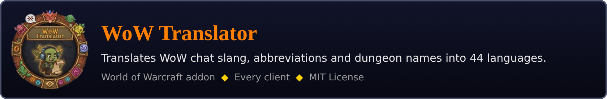
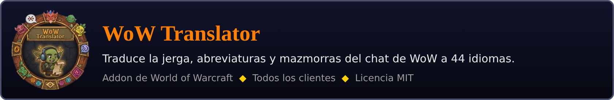

<strong>English</strong> · <em>Español más abajo</em> · <a href="https://github.com/Pirson-s-Addons/WoW-Translator" rel="nofollow">Source code on GitHub</a>

***

## Watch it in action

 <em>Setup and usage guide on YouTube</em>

## What it does

**WoW Translator translates chat messages in real time, right inside your chat window.** No alt-tabbing, no copy-pasting into a browser, no interruptions.

Playing on a realm full of French, German and Spanish speakers, joining an international guild or pugging Mythic+ with players from three countries: WoW Translator removes the language barrier so you can focus on the pull.

It is **built for World of Warcraft players**: it recognizes MMO slang, raid terminology, trade abbreviations and everyday in-game expressions, the shorthand that generic translators turn into nonsense.

> **Example:** `LF1M tank M+ KSM link` stays readable instead of becoming a word salad.

## Features

| Feature | What it does |
|---|---|
| **Real-time translation** | Messages are translated instantly, inline in your chat window |
| **Built for WoW** | Understands raid callouts, dungeon terms, class abbreviations and trade slang |
| **44 languages** | Full multi-language support, including regional variants |
| **Every chat channel** | Say, Party, Guild, Raid and World |
| **Lightweight** | Minimal footprint: no lag, no chat spam, no intrusive frames |
| **Easy to set up** | A clean settings panel plus quick slash commands |
| **Toggle anytime** | Turn translations on or off with a single command |

## Screenshot

 <em>Live translations inside the chat window</em>

## Slash commands

| Command | What it does |
|---|---|
| `/wt` | Opens the help menu |
| `/wt config` | Opens the settings panel |
| `/wt on` | Enables translations |
| `/wt off` | Disables translations |
| `/wt test` | Sends a test translation |

## Installation

1. Install it with the **CurseForge app** (recommended: it keeps the addon updated and puts it in the right client), or download the ZIP.
2. If you install by hand, extract the folder into `World of Warcraft/<version>/Interface/AddOns/`, for example `_retail_`, `_classic_beta_` (WoW Forever), `_classic_era_` or `_classic_`.
3. Launch the game and make sure **WoW Translator** is enabled in the AddOns list.
4. Type `/wt config` to choose your language.

## Compatibility

**One download works on every version of the game**: Retail and every Classic client.

| Game | Client versions |
|---|---|
| **WoW Forever (Classic+)** | 1.60.1 (beta) |
| **Retail: Midnight** | 12.1.5 · 12.1.0 · 12.0.7 · 12.0.5 · 12.0.1 |
| **Mists of Pandaria Classic** | 5.5.4 · 5.5.3 · 5.5.2 · 5.5.1 · 5.5.0 |
| **Cataclysm Classic** | 4.4.2 · 4.4.1 · 4.4.0 |
| **Wrath: Titan Reforged & Classic** | 3.80.2 · 3.80.1 · 3.80.0 · 3.4.5 · 3.4.4 · 3.4.3 · 3.4.2 · 3.4.1 · 3.4.0 |
| **Burning Crusade Classic & Anniversary** | 2.5.6 · 2.5.5 · 2.5.4 · 2.5.3 · 2.5.2 · 2.5.1 |
| **Classic Era, Anniversary, Hardcore & Season of Discovery** | 1.15.9 · 1.15.8 · 1.15.7 · 1.15.6 · 1.15.5 · 1.15.4 · 1.15.3 · 1.15.2 · 1.15.1 · 1.15.0 |
| **Legacy clients** \* | 11.2.7 · 10.2.7 · 9.2.5 · 8.3.7 · 7.3.5 · 6.2.4 · 5.4.8 · 4.3.4 · 3.3.5a · 2.4.3 |

<em>\* Supported since v2.02. They are older than multi-TOC support, so they only read `WoWTranslator.toc`: delete it and rename the `.toc` of your expansion, for example `WoWTranslator-Legion.toc` on 7.3.5 or `WoWTranslator_Wrath.toc` on 3.3.5a. Vanilla 1.12.1 is not supported: that client runs an older Lua the addon cannot use.</em>

## Languages (44)

English · Spanish (Spain) · Spanish (Latam) · German · French · Italian · Portuguese · Russian · Korean · Simplified Chinese · Traditional Chinese · Japanese · Polish · Swedish · Norwegian · Danish · Finnish · Dutch · Turkish · Arabic · Persian · Hebrew · Hindi · Bengali · Urdu · Tamil · Telugu · Thai · Vietnamese · Indonesian · Malay · Czech · Slovak · Hungarian · Romanian · Bulgarian · Greek · Ukrainian · Croatian · Serbian · Slovenian · Lithuanian · Latvian · Estonian

## FAQ

**Does it translate my own messages too?** It focuses on incoming chat so you understand what others say. Check `/wt config` for the available options.

**Does it work on WoW Forever?** Yes, since v2.03, in the same download as every other version. Forever uses the modern interface, so everything works as on Retail: chat translation, Group Finder tooltips and the full settings panel.

**Will it spam my chat?** No. Translations sit cleanly in the chat window and stay readable in raids and busy world channels.

**Does it affect performance?** No noticeable impact on FPS: it is built to be lightweight.

**Translations aren't showing up.** Turn them on with `/wt on` and run `/wt test`. If it still fails, please report it in the Issues section.

**I found a bad translation, or my language is missing.** Leave a comment or open an issue with the original message and the expected translation.

## Support the project

WoW Translator is made in my free time. If it saved you from a "what did he just say?" wipe, you can support it:

**Leave a comment, a rating, or share it with your guild**: it really helps the addon reach more players.

***

<strong>Español</strong> · <a href="https://github.com/Pirson-s-Addons/WoW-Translator" rel="nofollow">Código fuente en GitHub</a>

## Qué hace

**WoW Translator traduce los mensajes del chat en tiempo real, dentro de la propia ventana de chat.** Sin alt-tab, sin copiar y pegar en el navegador, sin interrumpir tu partida.

Si juegas en un reino lleno de franceses, alemanes e ingleses, estás en una hermandad internacional o haces Mítica+ con gente de tres países, WoW Translator elimina la barrera del idioma para que te centres en el pull.

Está **hecho para jugadores de WoW**: reconoce jerga MMO, terminología de bandas, abreviaturas de comercio y expresiones del juego, esos atajos que los traductores genéricos convierten en un sinsentido.

> **Ejemplo:** `BL1M tank M+ KSM link` sigue siendo legible en lugar de acabar en una frase ininteligible.

## Funciones

| Función | Qué hace |
|---|---|
| **Traducción en tiempo real** | Los mensajes se traducen al instante dentro del propio chat |
| **Hecho para WoW** | Entiende términos de banda, mazmorras, clases y comercio |
| **44 idiomas** | Soporte multilenguaje completo, con variantes regionales |
| **Todos los canales** | Decir, Grupo, Hermandad, Banda y Mundo |
| **Ligero** | Impacto mínimo: sin lag, sin spam, sin ventanas intrusivas |
| **Fácil de configurar** | Panel de ajustes claro y comandos rápidos |
| **Actívalo cuando quieras** | Enciende o apaga las traducciones con un solo comando |

## Captura

 <em>Traducciones en directo en la ventana de chat</em>

## Comandos

| Comando | Qué hace |
|---|---|
| `/wt` | Abre el menú de ayuda |
| `/wt config` | Abre la configuración |
| `/wt on` | Activa las traducciones |
| `/wt off` | Desactiva las traducciones |
| `/wt test` | Envía un mensaje de prueba |

## Instalación

1. Instálalo con la **app de CurseForge** (recomendado: se actualiza solo y lo coloca en el cliente correcto) o descarga el ZIP.
2. Si lo instalas a mano, descomprime la carpeta en `World of Warcraft/<versión>/Interface/AddOns/`, por ejemplo `_retail_`, `_classic_beta_` (WoW Forever), `_classic_era_` o `_classic_`.
3. Entra al juego y comprueba que **WoW Translator** está activado en la lista de addons.
4. Escribe `/wt config` para elegir tu idioma.

## Compatibilidad

**Una sola descarga funciona en todas las versiones del juego**: Retail y todos los clientes Classic.

| Juego | Versiones de cliente |
|---|---|
| **WoW Forever (Classic+)** | 1.60.1 (beta) |
| **Retail: Midnight** | 12.1.5 · 12.1.0 · 12.0.7 · 12.0.5 · 12.0.1 |
| **Mists of Pandaria Classic** | 5.5.4 · 5.5.3 · 5.5.2 · 5.5.1 · 5.5.0 |
| **Cataclysm Classic** | 4.4.2 · 4.4.1 · 4.4.0 |
| **Wrath: Titan Reforged y Classic** | 3.80.2 · 3.80.1 · 3.80.0 · 3.4.5 · 3.4.4 · 3.4.3 · 3.4.2 · 3.4.1 · 3.4.0 |
| **Burning Crusade Classic y Anniversary** | 2.5.6 · 2.5.5 · 2.5.4 · 2.5.3 · 2.5.2 · 2.5.1 |
| **Classic Era, Anniversary, Hardcore y Season of Discovery** | 1.15.9 · 1.15.8 · 1.15.7 · 1.15.6 · 1.15.5 · 1.15.4 · 1.15.3 · 1.15.2 · 1.15.1 · 1.15.0 |
| **Clientes antiguos** \* | 11.2.7 · 10.2.7 · 9.2.5 · 8.3.7 · 7.3.5 · 6.2.4 · 5.4.8 · 4.3.4 · 3.3.5a · 2.4.3 |

<em>\* Soportados desde la v2.02. Son anteriores al soporte de varios `.toc`, así que solo leen `WoWTranslator.toc`: bórralo y renombra el `.toc` de tu expansión, por ejemplo `WoWTranslator-Legion.toc` en un 7.3.5 o `WoWTranslator_Wrath.toc` en un 3.3.5a. Vanilla 1.12.1 no está soportado: ese cliente usa una versión de Lua más antigua con la que el addon no puede funcionar.</em>

## Idiomas (44)

Inglés · Español (España) · Español (Latam) · Alemán · Francés · Italiano · Portugués · Ruso · Coreano · Chino simplificado · Chino tradicional · Japonés · Polaco · Sueco · Noruego · Danés · Finlandés · Neerlandés · Turco · Árabe · Persa · Hebreo · Hindi · Bengalí · Urdu · Tamil · Telugu · Tailandés · Vietnamita · Indonesio · Malayo · Checo · Eslovaco · Húngaro · Rumano · Búlgaro · Griego · Ucraniano · Croata · Serbio · Esloveno · Lituano · Letón · Estonio

## Preguntas frecuentes

**¿También traduce mis propios mensajes?** Se centra en el chat entrante para que entiendas lo que dicen los demás. Revisa `/wt config` para ver las opciones.

**¿Funciona en WoW Forever?** Sí, desde la v2.03, en la misma descarga que el resto de versiones. Forever usa la interfaz moderna, así que todo funciona igual que en Retail: traducción del chat, tooltips del Buscador de grupos y el panel de opciones completo.

**¿Va a llenarme el chat de spam?** No. Las traducciones se integran de forma limpia y siguen siendo legibles en plena banda o en canales muy activos.

**¿Afecta al rendimiento?** Sin impacto apreciable en los FPS: está pensado para ser ligero.

**No me aparecen las traducciones.** Actívalas con `/wt on` y ejecuta `/wt test`. Si sigue fallando, repórtalo en la sección de Issues.

**He visto una traducción incorrecta, o falta mi idioma.** Deja un comentario o abre un issue con el mensaje original y la traducción esperada.

## Apoya el proyecto

WoW Translator se hace en mi tiempo libre. Si te ha salvado de un wipe por un "¿qué ha dicho?", puedes apoyarlo:

**Deja un comentario, una valoración o compártelo con tu hermandad**: ayuda muchísimo a que el addon llegue a más jugadores.

***

<em>WoW Translator: chat translator addon · real-time translation · multilanguage chat · MMO slang · raid abbreviations · guild, party and world chat · international guilds · auto translate · traductor de chat · traducción en tiempo real. Compatible with WoW Forever (Classic+), Midnight, Retail, The War Within, Dragonflight, Shadowlands, Battle for Azeroth, Legion, Warlords of Draenor, Mists of Pandaria Classic, Cataclysm Classic, Wrath Titan Reforged, WotLK Classic, Burning Crusade Classic, TBC Anniversary, Classic Era, Hardcore and Season of Discovery.</em>
