

<a href="README.md">English</a> · <b>Español</b>

<table width="100%">
<tr>
<td width="50%" align="center">  </td>
<td width="50%" align="center">  </td>
</tr>
<tr>
<td width="50%" align="center">  </td>
<td width="50%" align="center">  </td>
</tr>
</table>

<table width="100%">
<tr>
<td width="50%" align="center">  </td>
<td width="50%" align="center">  </td>
</tr>
<tr>
<td width="50%" align="center">  </td>
<td width="50%" align="center">  </td>
</tr>
<tr>
<td width="50%" align="center">  </td>
</tr>
</table>

<table width="100%">
<tr>
<td width="50%" align="center">  </td>
<td width="50%" align="center">  </td>
</tr>
<tr>
<td width="50%" align="center">  </td>
<td width="50%" align="center"> </td>
</tr>
</table>

<table width="100%">
<tr>
<td width="50%" align="center">  </td>
<td width="50%" align="center">  </td>
</tr>
<tr>
<td width="50%" align="center">  </td>
<td width="50%" align="center">  </td>
</tr>
</table>

<table width="100%">
<tr>
<td width="50%" align="center">  </td>
<td width="50%" align="center">  </td>
</tr>
</table>

<table width="100%">
<tr>
<td width="50%" align="center">  </td>
<td width="50%" align="center">  </td>
</tr>
<tr>
<td width="50%" align="center">  </td>
<td width="50%" align="center">  </td>
</tr>
</table>

Las cifras se actualizan cada lunes desde CurseForge. Última actualización: 2026-11-23.

<b>Código fuente en GitHub</b>

- [WoW Translator](https://github.com/Pirson-s-Addons/WoW-Translator)
- [Dungeon Quest Atlas](https://github.com/Pirson-s-Addons/DungeonQuestAtlas)
- [HandyNotes: Dungeon & Raid Locations](https://github.com/Pirson-s-Addons/HandyNotes_DungeonRaidLocations-Forever)
- [Health Bar Text Forever](https://github.com/Pirson-s-Addons/HealthBarTextForever)
- [Seal Timers Forever](https://github.com/Pirson-s-Addons/SealTimersForever)
- [Gather Radar](https://github.com/Pirson-s-Addons/GatherRadar)
- [Remove Questie](https://github.com/Pirson-s-Addons/RemoveQuestie)
- [HandyNotes: Trove of the Thunder King](https://github.com/Pirson-s-Addons/HandyNotes_Trove-Thunder-King)
- [DR Tracker Forever](https://github.com/Pirson-s-Addons/DRTrackerForever)
- [Map Fix Forever](https://github.com/Pirson-s-Addons/MapFixForever)
- [Cursor Glow RGB](https://github.com/Pirson-s-Addons/Cursor-Glow-RGB)
- [Prospect Helper](https://github.com/Pirson-s-Addons/ProspectHelper)
- [Mill Helper](https://github.com/Pirson-s-Addons/MillHelper)
- [Vendor Item Filter](https://github.com/Pirson-s-Addons/VendorItemFilter)
- [Move Extra Action Button](https://github.com/Pirson-s-Addons/MoveExtraActionButton)
- [Emoji & React](https://github.com/Pirson-s-Addons/EmojiReact)
- [Leave Instance Group](https://github.com/Pirson-s-Addons/LeaveInstanceGroup)
- [Rotation Guide](https://github.com/Pirson-s-Addons/RotationGuide)
- [Loot-A-Rang Classic](https://github.com/Pirson-s-Addons/Loot-A-Rang-Classic)
- [Azeroth Tic-Tac-Toe](https://github.com/Pirson-s-Addons/AzerothTicTacToe)
- [Chocolate XP Bar](https://github.com/Pirson-s-Addons/ChocolateXPBar)
- [Profession Reagents](https://github.com/Pirson-s-Addons/ProfessionReagents)

 

## Contribuir

Las pull requests son bienvenidas: haz un fork del repositorio, crea una rama y abre una Pull Request.

## Licencia

Todos los addons usan la licencia MIT, excepto **Dungeon Quest Atlas** y **Azeroth AI** (todos los derechos reservados). Cada repositorio incluye su propio archivo `LICENSE`.

 


