

<b>English</b> · <a href="README.es.md">Español</a>

  <a href="https://www.curseforge.com/wow/addons/dungeon-quest-atlas"></a>
  
  <a href="https://www.curseforge.com/wow/addons/handynotes-trove-of-the-thunder-king"></a>
  

  
  
  
  
  <a href="https://www.curseforge.com/wow/addons/chocolate-xp-bar"></a>

  <a href="https://www.curseforge.com/wow/addons/wow-translator"></a>
  
  <a href="https://www.curseforge.com/wow/addons/azeroth-tic-tac-toe"></a>
  <a href="https://www.curseforge.com/wow/addons/azeroth-ai"></a>

  
  
  <a href="https://www.curseforge.com/wow/addons/mill-helper"></a>

  <a href="https://www.curseforge.com/wow/addons/dr-tracker-forever"></a>
  <a href="https://www.curseforge.com/wow/addons/rotation-guide"></a>

  <a href="https://www.curseforge.com/wow/addons/remove-questie"></a>
  
  
  <a href="https://www.curseforge.com/wow/addons/loot-a-rang-classic"></a>

Numbers refresh every Monday from CurseForge. Last update: 2026-11-17.

<b>Source code on GitHub</b>

- [WoW Translator](https://github.com/Pirson-s-Addons/WoW-Translator)
- [Dungeon Quest Atlas](https://github.com/Pirson-s-Addons/DungeonQuestAtlas)
- [HandyNotes: Dungeon & Raid Locations](https://github.com/Pirson-s-Addons/HandyNotes_DungeonRaidLocations-Forever)
- [Health Bar Text Forever](https://github.com/Pirson-s-Addons/HealthBarTextForever)
- [Seal Timers Forever](https://github.com/Pirson-s-Addons/SealTimersForever)
- [Remove Questie](https://github.com/Pirson-s-Addons/RemoveQuestie)
- [Gather Radar](https://github.com/Pirson-s-Addons/GatherRadar)
- [HandyNotes: Trove of the Thunder King](https://github.com/Pirson-s-Addons/HandyNotes_Trove-Thunder-King)
- [Map Fix Forever](https://github.com/Pirson-s-Addons/MapFixForever)
- [DR Tracker Forever](https://github.com/Pirson-s-Addons/DRTrackerForever)
- [Cursor Glow RGB](https://github.com/Pirson-s-Addons/Cursor-Glow-RGB)
- [Prospect Helper](https://github.com/Pirson-s-Addons/ProspectHelper)
- [Mill Helper](https://github.com/Pirson-s-Addons/MillHelper)
- [Move Extra Action Button](https://github.com/Pirson-s-Addons/MoveExtraActionButton)
- [Vendor Item Filter](https://github.com/Pirson-s-Addons/VendorItemFilter)
- [Leave Instance Group](https://github.com/Pirson-s-Addons/LeaveInstanceGroup)
- [Emoji & React](https://github.com/Pirson-s-Addons/EmojiReact)
- [Loot-A-Rang Classic](https://github.com/Pirson-s-Addons/Loot-A-Rang-Classic)
- [Azeroth Tic-Tac-Toe](https://github.com/Pirson-s-Addons/AzerothTicTacToe)
- [Chocolate XP Bar](https://github.com/Pirson-s-Addons/ChocolateXPBar)
- [Rotation Guide](https://github.com/Pirson-s-Addons/RotationGuide)


 

## Contributing

Pull requests are welcome: fork the repository, create a branch and open a Pull Request.

## License

Every addon is under the MIT License, except **Dungeon Quest Atlas** and **Azeroth AI** (All Rights Reserved). Each repository includes its own `LICENSE` file.

 

